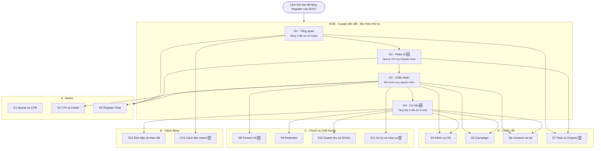

# Report AOV — "Làm thế nào để tăng Register?"

Thiết kế Power BI report trả lời câu hỏi lớn của business: **làm thế nào để tăng Register của AOV**.

| | |
|---|---|
| Logic tree | [OM Logic Tree v4 - Final](https://docs.google.com/spreadsheets/d/1VGflfRMM5Qm2RJ-VjvX3ecW5fTlGjj1e3dbHPXvnk1o/edit?gid=445378094#gid=445378094) |
| Semantic model | `AOV VN - OM` — workspace `[ODP] Model` |
| Fact chính | `Latte_db` (install, register, spend, retention, revenue) + `ads_manager` (impression, click, CPM) |
| Scope | UA paid + Organic. Re-engagement (UE) để riêng, không trộn vào Register |
| Sơ đồ tương tác | https://claude.ai/artifact/Cp4PufaxrY9QytvbgNj8Sf — bản đầy đủ, có chi tiết từng chart |
| Bản offline | [`blueprint.html`](./blueprint.html) — mở thẳng bằng trình duyệt, không cần mạng |

---

## Xương sống

```
Register       = Install × Register Rate = (Spend ÷ CPI) × Register Rate
Register tổng  = OM (paid) + organic + organicA
CPR            = Spend ÷ Register = CPI ÷ Register Rate
```

Chỉ có **ba đòn bẩy**: Spend, CPI, Register Rate. Toàn bộ report xoay quanh việc trả lời cái nào đang đổi, đổi ở segment nào, vì sao, và kéo được bằng lever nào.

---

## Cấu trúc hub and spoke — 17 page

**Hub** dẫn người đọc đi đúng thứ tự suy luận. **Spoke** là thư viện tra cứu, mở ra khi cần số chi tiết.



🆕 = page mới so với bản draft. Sáu page mới, mười một page kế thừa.

### Hub

| | Page | Trả lời | Nguồn |
|---|---|---|---|
| H1 | Tổng quan Register | Đang bao nhiêu, so target và so D-1 thế nào, phần nào là của paid | Draft page 1 |
| H2 | Phân rã Register | Register đổi bao nhiêu, Spend / CPI / Register Rate đóng góp bao nhiêu | **Mới** |
| H3 | Chẩn đoán | Lệch là vì đâu — bốn bước cố định thay vì mò | Draft page 11 + 12 gộp |
| H4 | Cơ hội và headroom | Thêm Register tiếp theo rẻ nhất nằm ở đâu | **Mới** |

### Spoke

| | Page | Nhóm | Nguồn |
|---|---|---|---|
| S1 | Spend và CPR | A · Metric | Draft page 2 + 3 gộp |
| S2 | CPI và Install | A · Metric | Draft page 4 |
| S3 | Register Rate | A · Metric | Draft page 5 |
| S4 | Kênh và OS | B · Chiều cắt | Draft page 6 |
| S5 | Campaign | B · Chiều cắt | Draft page 7 |
| S6 | Creative và Ad | B · Chiều cắt | Draft page 8 |
| S7 | Paid và Organic | B · Chiều cắt | **Mới** |
| S8 | Funnel UA | C · Chuỗi và chất lượng | **Mới** |
| S9 | Retention | C · Chuỗi và chất lượng | Draft page 9 |
| S10 | Doanh thu và ROAS | C · Chuỗi và chất lượng | Draft page 10 |
| S11 | So kỳ và mùa vụ | C · Chuỗi và chất lượng | **Mới** |
| S12 | Đòn bẩy và theo dõi | D · Hành động | Draft page 13 |
| S13 | Cách đọc report | D · Hành động | **Mới** |

Không page nào của draft bị bỏ.

---

## Điểm cần cải thiện ở bản draft

Draft hiện tại: `OM AOV Logic Tree Demo.Report` trong workspace `[ODP] Report`, 13 page chia theo từng metric. Cách chia đó **không sai** — Spend, CPI, Register Rate đúng là ba thành phần của công thức. Dưới đây là những gì nên bổ sung.

### Cấu trúc

| # | Vấn đề | Cách xử lý |
|---|---|---|
| 1 | **Ba metric nằm ba page nên không so được với nhau.** Câu hỏi thật luôn là "do Spend, do CPI hay do Register Rate" — cần ba số cạnh nhau, cùng kỳ so sánh, trên một màn hình | Thêm page **H2 Phân rã** với waterfall |
| 2 | **Không lượng hoá được đóng góp.** Biết "CPI +8%" nhưng không biết 8% đó làm mất bao nhiêu Register | Waterfall ở H2, cộng card quy đổi trên mỗi page metric |
| 3 | **13 page ngang hàng, không có thứ tự đọc** | Đánh số theo nhóm, thêm nav bar bookmark, thêm 4 page hub |
| 4 | **Nguyên nhân và Chẩn đoán tách hai page** khiến người đọc phải nhớ số qua hai lần bấm | Gộp thành một mạch bốn bước (H3) |
| 5 | **Nội dung trùng giữa page metric và page segmentation** — mỗi page chiều cắt lại nhắc lại đủ năm metric | Tách vai trò: metric page nói về mức và biến động, segmentation page nói về phân bố |

### Lỗ hổng so với logic tree

| # | Thiếu | Nhánh | Vì sao quan trọng |
|---|---|---|---|
| 6 | **Paid vs Organic** | 1 Segmentation + 5 Algebra | Organic ~12.0M vs OM paid ~1.79M Register trong 3 tháng gần nhất. Chart "Register tổng" nào không tách `media_group` đều đang để nền organic che biến động của paid — rủi ro đọc sai lớn nhất |
| 7 | **Funnel UA** | 3 Process | Có metric rời nhưng không có chuỗi, nên không biết tắc ở *bước* nào, chỉ biết *metric* nào xấu |
| 8 | **Cơ hội / headroom** | 6 Action levers | Page Đòn bẩy trả lời "sửa gì khi hỏng". Chưa có page trả lời "tăng ở đâu rẻ nhất" khi mọi thứ vẫn chạy bình thường — mà đó mới là câu hỏi lớn |
| 9 | **So kỳ và mùa vụ** | 1 Segmentation + 4 Conceptual | Phải loại trừ chu kỳ trước khi đổ lỗi cho campaign |

Hai thứ draft **bỏ qua là đúng**: Customer lifecycle (`group_name`) thuộc UE, ngoài scope; Competitor và Measurement thì model không có data.

### Chi tiết kỹ thuật

| # | Việc | Lý do |
|---|---|---|
| 10 | **Bỏ mọi visual dùng `Age`, `Gender`, `Audience`** làm nhân khẩu học | Ba cột này là mảnh vỡ khi tách tên campaign (`"1865"`, `"A"`, `"CA0007"`), trên 97% để trống |
| 11 | **Sync slicer toàn report** + banner `AllFiltersText` ở đầu mỗi page | Chart dùng để chụp màn hình gửi stakeholder; ảnh không ghi rõ phạm vi lọc rất dễ bị hiểu nhầm |
| 12 | **Thêm card quy đổi ra Register** trên S1, S2, S3 | Giữ được ưu điểm tra cứu của metric-first mà mỗi page lẻ vẫn trả lời được câu hỏi lớn |

---

## Ghi chú dữ liệu

Đã kiểm tra trực tiếp trên model qua XMLA.

| | |
|---|---|
| **Độ phủ thời gian** | `Latte_db` 01/01/2024 → D-1. `ads_manager` 01/01/2025 → hôm nay. Bảng `Date` tới 31/12/2026, nên so cùng kỳ năm trước dùng được |
| **Impression / Click chỉ 3 kênh** | `ads_manager` chỉ có `facebook ads`, `googleadwords_int`, `tiktokglobal_int`. Appier, Moloco, Apple Search Ads, Oppo không có CTR / CPM. Funnel đầy đủ chỉ vẽ được cho 3 kênh |
| **Hai fact chỉ nối qua Date** | `ads_manager` và `Latte_db` không có quan hệ ở mức campaign — một slicer kênh không lọc đồng thời cả hai. Muốn cắt đồng bộ phải thêm bảng dimension Channel dùng chung |
| **Age / Gender / Audience** | Không dùng được, xem mục 10 ở trên |
| **Tên campaign** | Dạng `AOV-VN-MAIA-AND-0429-06JUN25-FANART+COMIC` chứa loại campaign, OS, ngày bắt đầu, chủ đề. Muốn cắt theo chủ đề thì thêm calculated column tách chuỗi |
| **Phân loại campaign** | `is_retarget_name` và `ads_manager[Campaign type]`: `MAIA` (UA), `MAEA` (re-engagement), `PB` (post boosting), `Others` |

### Measure cần viết thêm

Chỉ ba measure, cho waterfall ở H2:

- `Δ Register from Spend`
- `Δ Register from CPI`
- `Δ Register from Register Rate`

Cách tính: tách tuần tự — thay từng yếu tố một, giữ các yếu tố còn lại ở kỳ gốc. Kém chính xác hơn công thức chỉ số kiểu LMDI một chút, nhưng giải thích được cho team trong một câu.

Mọi measure còn lại đã có sẵn trong model (`Compare`, `% change`, `Daily vs Target`, `Daily Performance Table`, `Target`, `ROAS - LTV`).

---

## Trạng thái

- [x] Bước 1 — Sơ đồ pages và charts
- [ ] Bước 2 — Dựng report trên semantic model `AOV VN - OM`
